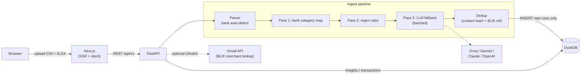

# SpendWisely

**Self-hosted personal finance analytics from raw bank exports.** Drop in a Pekao CSV or Millennium XLSX. SpendWisely parses it, removes duplicates, categorises each transaction through a rules-first pipeline with an LLM fallback, and serves FX-aware spend, income and forecast analytics from a single DuckDB file.

[](#) [](#) [](#) [](#) [](LICENSE)

---

## Tech stack

| Layer    | Technology |
|----------|------------|
| API      | Python 3.11 · FastAPI · Pydantic v2 · pandas |
| Storage  | DuckDB (embedded, single file) |
| Frontend | Next.js 16 (App Router, RSC) · TypeScript · Tailwind · shadcn/ui · Recharts |
| AI       | Pluggable LLM provider: Groq (default, free tier) · Gemini · Claude · OpenAI |
| Infra    | Docker Compose (dev with hot reload, prod behind nginx) |

---

## Architecture



**Request flow**

1. `POST /api/v1/ingest` writes the upload to a temp file. `detect_and_parse()` picks the bank parser from the file extension and headers, then normalises Polish locale dates (`DD.MM.YYYY`) and amounts (`1 464,99`).
2. `BankEnricher` runs the three categorisation passes. Each pass only touches rows still marked `Uncategorized`.
3. Rows are checked against existing IDs and only new ones are inserted.
4. The analytics endpoints (`/insights/*`) load a filtered frame and compute summaries, recurring costs, deltas, velocity and predictions. Next.js server components fetch these directly over the Docker network.

---

## Engineering highlights

### Idempotent ingestion
- Every transaction gets a deterministic ID: a SHA-1 of booking date, bank reference, amount and currency. For Millennium, the hash covers date, amount, title and running balance. Re-importing the same file, or two overlapping export windows, inserts nothing twice.
- **BLIK pending→settled dedup.** A BLIK payment can show up twice with different booking dates, so the hashes differ. A second pass matches on the `BLIK REF` number plus amount and currency, and drops the duplicate.
- The typed `IngestResult` reports `imported`, `duplicates_skipped`, `internal_marked` and `categorized`, so the client can show exactly what changed.

### Correct money semantics
- **No FX double counting.** Currency exchange rows (`Wymiana walut …`) and own-account transfers are flagged `is_internal` and excluded from every spend and income aggregate.
- **USD income normalisation.** USD inflows are converted with an implied PLN/USD rate taken from the paired FX rows. No external rate API is used.
- **Salary period attribution.** `thruMMMDD` tokens in transfer titles move early-posted salaries into the month they pay for, including across a year boundary.

### Deterministic-first categorisation
- Rules run before the LLM. Bank-native categories and an ordered regex rule set (non-capturing groups, priority-ranked) cover most rows offline, so the app is fully usable without an API key.
- **LLM as a bounded fallback.** Only uncategorised, non-internal expenses are sent, in batches of 60. A failed batch is logged and skipped while the other batches still apply. The error is raised only if every batch fails.
- **Provider abstraction.** `LLMProvider` is an ABC with Groq, Gemini, Claude (with prompt caching) and OpenAI implementations behind one factory. You can switch provider through env vars or the in-app settings panel.
- **Learning loop.** Bulk-categorising in the post-import review can save an auto-generated rule (`priority=5`, `comment="auto:<counterparty>"`). The rule is applied right away to all matching uncategorised rows.

### Concurrency & abuse control
- DuckDB's connection is not thread-safe. Analytics reads are serialised with a `threading.Lock` so FastAPI's thread pool can't race on it.
- `POST /categories/suggest`, which spends LLM tokens, has a per-IP sliding-window rate limit (`SUGGEST_RATE_LIMIT` / `SUGGEST_RATE_WINDOW`). It returns `429` when the limit is exceeded.

### Schema & validation
- Request and response models use Pydantic v2. Settings are typed through `pydantic-settings`.
- The schema lives in `database.py`. Migrations are explicit SQL, with no ORM magic.

---

## Getting started

### Docker Compose (recommended)

```bash
git clone https://github.com/yehomak/SpendWisely.git
cd SpendWisely
cp v2/backend/.env.example v2/backend/.env   # optional: add an LLM key
docker compose up --build
```

| Service      | URL |
|--------------|-----|
| Frontend     | http://localhost:3000 |
| API (OpenAPI)| http://localhost:8000/docs |

Source directories are bind-mounted, so uvicorn `--reload` and Next.js HMR pick up changes without a rebuild. The database is stored in `./db/`.

### Production

```bash
docker compose -f docker-compose.prod.yml up -d --build
```

nginx listens on `:80` and routes `/api/` to FastAPI and `/` to Next.js. The DuckDB file lives in the named volume `spendwisely_db`. For TLS, put `fullchain.pem` and `privkey.pem` in `docker/nginx/certs/` and uncomment the HTTPS block in `docker/nginx/nginx.conf`.

### Without Docker

```bash
./setup.sh                                                   # venv + npm install + .env
cd v2/backend  && source .venv/bin/activate && uvicorn app.main:app --reload
cd v2/frontend && npm run dev
```

---

## Configuration

`v2/backend/.env.example`:

```dotenv
# ── LLM categorisation (optional — app works on bank category + regex rules without it)
# Provider: groq | gemini | claude | openai
LLM_PROVIDER=groq
# Leave blank to use the provider default model
LLM_MODEL=

# Free tier: https://console.groq.com/keys
GROQ_API_KEY=
# Free tier: https://aistudio.google.com/apikey
GOOGLE_API_KEY=
ANTHROPIC_API_KEY=
OPENAI_API_KEY=

# ── Storage
# Overridden to /data/spendwisely.duckdb inside Docker
DB_PATH=./spendwisely.duckdb

# ── Ingest
# Your name as it appears in bank transfer descriptions (detects own-account transfers)
OWNER_NAME=

# ── AI suggest rate limit (per client IP)
SUGGEST_RATE_LIMIT=5
SUGGEST_RATE_WINDOW=600

# ── Gmail enrichment (optional, OAuth2 Web credential from Google Cloud Console)
GMAIL_CLIENT_ID=
GMAIL_CLIENT_SECRET=
GMAIL_REDIRECT_URI=http://localhost:8000/api/v1/gmail/callback
```

Default models: Groq `llama-3.3-70b-versatile`, Gemini `gemini-2.0-flash`, OpenAI `gpt-4o-mini`, Claude `claude-sonnet-4-6`. Set `LLM_MODEL` to override.

Frontend (set in the compose files): `NEXT_PUBLIC_API_URL` is used for browser fetches and `API_URL` for server-side rendering (`http://backend:8000/api/v1` inside Docker).

---

## Repository layout

```
v2/backend/app/
  services/parser.py     Bank detection, locale parsing, FX/internal flags, content-hash IDs
  services/enricher.py   3-pass categorisation pipeline + rule store
  services/llm.py        LLMProvider ABC + Groq / Gemini / Claude / OpenAI
  services/insights.py   Analytics (summaries, recurring, deltas, velocity, predictions)
  routers/               /ingest  /transactions  /insights  /categories  /settings  /gmail
  database.py            DuckDB schema + connection
v2/frontend/
  app/                   Dashboard, Insights, Plan, Transactions (App Router)
  components/            Feature components + shadcn/ui primitives
  lib/api.ts             Typed API client — single source of truth for endpoints
docker/nginx/            Reverse proxy config for prod
```

Design rationale is in [`DECISIONS.md`](DECISIONS.md), and bank-format quirks are in [`GOTCHAS.md`](GOTCHAS.md).

---

## Roadmap

- [ ] Manual cash entry
- [ ] Apple Wallet export ingestion
- [ ] Inline category editing on the transactions table

## License

[MIT](LICENSE)
